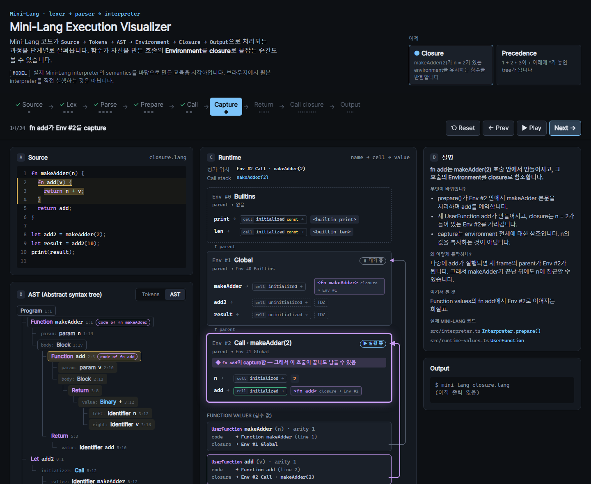
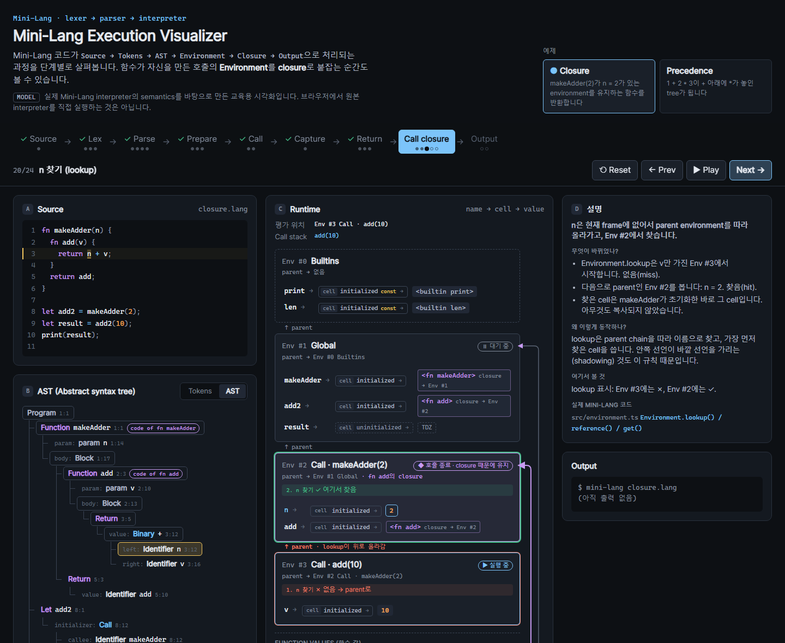
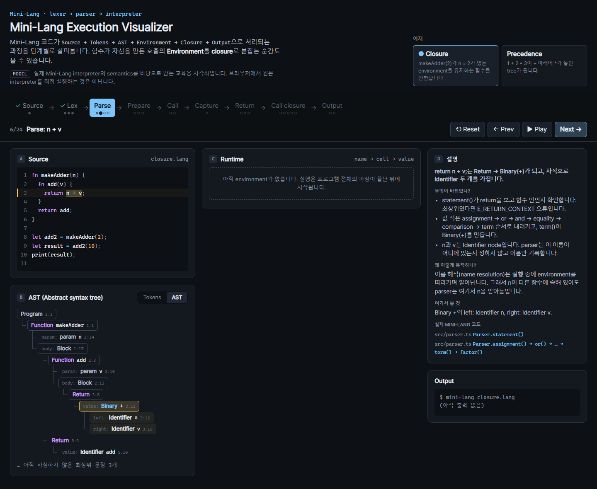

# Mini-Lang Execution Visualizer

**Mini-Lang 프로그램을 소스 텍스트부터 출력까지 한 단계씩 따라가고, closure가 자신을 만든 호출의 Environment를 계속 살려 두는 모습을 확인합니다.** [Mini-Lang](#mini-lang과의-관계)이 프로그램을 실행하는 과정을 보여 주는 인터랙티브 시각화입니다. Mini-Lang은 TypeScript로 처음부터 작성한 작은 교육용 interpreter입니다.



> 이 Visualizer는 교육 목적으로 Mini-Lang의 semantics를 모델링한 것입니다. 브라우저에서 원본 interpreter를 실행하지는 않습니다.

## 보여 주는 것

프로그램 하나를 네 개의 연결된 패널로 보여 줍니다.

| 패널 | 내용 |
|---|---|
| **A. Source** | 프로그램 코드. 현재 token, 식, 문장의 범위가 강조됩니다 |
| **B. Tokens / AST** | lexer가 만든 token 목록, 그다음 tree 형태의 AST. token이나 node에 마우스를 올리면 소스에서 해당 범위가 강조됩니다 |
| **C. Runtime** | `parent`로 연결된 Environment frame, 각 이름 → BindingCell → 값, `code`와 `closure`를 가진 함수 값, parent chain을 따라가는 lookup, return 값을 운반하는 `Completion` |
| **D. 설명 / Output** | 단계마다 핵심 한 문장, 그리고 *무엇이 바뀌었나? · 왜 이렇게 동작하나? · 여기서 볼 것 · 실제 Mini-Lang 코드*(실제 파일과 함수), 프로그램 출력 |

위쪽 타임라인은 실행 흐름을 따라갑니다.

`Source → Lex → Parse → Prepare → Call → Capture → Return → Call closure → Output`

## 시나리오

Mini-Lang에는 익명 함수 표현식이 없으므로, closure는 이름 있는 안쪽 함수를 반환하는 방식으로 만듭니다.

```text
fn makeAdder(n) {
  fn add(v) {
    return n + v;
  }
  return add;
}

let add2 = makeAdder(2);
let result = add2(10);
print(result);
```

24단계에 걸쳐 다음을 볼 수 있습니다.

1. **Lex**: kind, lexeme, `line:column`을 가진 token 44개. 마지막은 `EOF`입니다.
2. **Parse**: `Function` 안에 중첩된 `Function`, `Binary(+)`가 된 `n + v`, postfix `Call`이 된 `makeAdder(2)`.
3. **Prepare**: runner가 `Builtins`(읽기 전용 `print`, `len`) ← `Global`을 만듭니다. `prepare()`가 `makeAdder`, `add2`, `result`를 예약합니다. 함수는 바로 초기화되고(hoisting), `let` 이름은 TDZ에 남습니다.
4. **Call**: `new Environment(callee.closure)`가 `n = 2`를 가진 Env #2를 만듭니다.
5. **Capture**: 본문에 대한 `prepare()`가 `closure → Env #2`인 `fn add`를 만듭니다.
6. **Return**: `return add;`는 `Completion { kind: 'return' }`을 만듭니다. 이 값은 문장 목록을 지나 호출 경계까지 전달됩니다. `makeAdder`는 반환되지만, `fn add`가 Env #2를 참조하므로 Env #2는 계속 남아 있습니다.
7. **Call closure**: `add2(10)`이 Env #3을 만듭니다. Env #3의 parent는 Global이 아니라 **Env #2**입니다. `n`을 찾을 때 Env #3에는 없고, 한 단계 위에서 `n = 2`를 찾습니다. `2 + 10 → 12`. 이후 아무도 capture하지 않은 Env #3은 해제됩니다.
8. **Output**: `print`를 Builtins에서 찾아 `12`를 출력합니다.



두 번째 짧은 예제(**Precedence**)는 `let x = 1 + 2 * 3;`를 파싱해 `Binary(*)`가 `Binary(+)`의 오른쪽 자식이 되는 모습을 보여 줍니다. `term()` / `factor()`가 왜 이런 모양을 만드는지 설명하고 `7`을 출력합니다.



## 다루는 interpreter 개념

- `SourceUnit` offset → `line:column`, token과 node의 span
- 직접 작성한 lexer: keyword와 identifier 구분, number literal 값, `EOF`
- Recursive-descent parser: 우선순위 단계마다 함수 하나, postfix 호출, 정적 검사(`E_DUPLICATE`, `E_RETURN_CONTEXT`)
- `Environment` → `BindingCell`(uninitialized / initialized, builtin은 `const`), parent chain lookup, TDZ
- `prepare()`: 재선언 검사, 이름 예약, 함수 hoisting
- `UserFunction` = code(선언 AST) + closure environment
- Lexical scope: call frame의 parent는 호출한 쪽이 아니라 callee의 closure
- `return`을 위한 `Completion` record와, 호출 경계에서 값을 꺼내는 과정
- 호출이 끝난 뒤에도 남는 environment와, 도달할 수 없게 되는 frame

## 실행

Node.js 20 이상이 필요합니다.

```bash
npm install
npm run dev        # http://localhost:5173
```

```bash
npm run typecheck
npm test
npm run build      # dist/에 정적 결과물 생성, 어느 경로에서도 동작 (base: './')
npm run preview
```

조작: **Reset**, **Prev**, **Play / Pause**, **Next**, 타임라인의 단계를 눌러 이동, 또는 키보드(`←` / `→`, `Home`, `End`). 단계마다 deep link가 있습니다. 예를 들어 `#closure/14`(capture)나 `#precedence/3`입니다.

## 구조

```text
src/
  model/
    types.ts          token, AST, runtime, scenario 타입
    runtime.ts        RuntimeDraft: createEnv / reserve / initialize / defineFunction /
                      lookup / enterCall / exitCall, Mini-Lang 규칙을 강제
    scenario.ts       placeTokens, span, buildStates (단계마다 불변 snapshot 하나)
    session.ts        순수 reducer: next / prev / goto / reset / play / pause / tick / deep link
  data/
    closureScenario.ts, precedenceScenario.ts   소스, token, AST, 단계와 설명
    conformance.test.ts                          데이터를 실제 Mini-Lang과 대조
  components/
    source/ tokens/ ast/ runtime/ controls/ explanation/
  styles/app.css      plain CSS, UI·animation library 없음
```

- **UI에는 semantics가 없습니다.** 각 단계는 `RuntimeDraft` API로 자신의 효과를 선언합니다. `buildStates`가 단계들을 미리 계산된 snapshot으로 접어 두므로, 어느 단계로 이동해도 결과가 결정적입니다. React 컴포넌트는 `StepView`를 그리기만 합니다.
- **모델이 실제 규칙을 강제합니다.** 예약된 cell의 1회 초기화, `E_REDECLARE`, 초기화 전 읽기의 `E_TDZ`, chain 전체를 따라간 뒤의 `E_UNDEFINED`를 검사합니다. lookup 경로는 손으로 적지 않고 parent를 실제로 따라가며 계산합니다. Mini-Lang과 어긋나는 단계는 state를 만드는 시점에 실패합니다.
- **Capture 화살표**는 DOM에서 측정한 SVG path입니다(`ResizeObserver`). 각 함수 값의 `closure` 행에서 해당 environment까지 그립니다.
- 애니메이션은 짧은 CSS transition과 keyframe이며, `prefers-reduced-motion`이면 모두 꺼집니다.

## 테스트

`npm test`는 모델에 대해 Vitest를 실행합니다.

- 초기 상태, 실행 흐름 순서의 단계(lex가 parse보다, parse가 모든 environment보다 먼저)
- `prepare()` 후의 hoisting과 TDZ
- `fn add`가 `makeAdder` frame을 capture하고, 그 frame이 return 후에도 남음
- closure 호출 frame의 parent가 capture된 environment이고, lookup 경로가 `Env #3 → Env #2`
- `return` completion, 결과 `12`, capture되지 않은 frame의 해제, Builtins를 통한 출력 `12`
- reducer: 경계, reset, play/tick/stop, 시나리오 전환, deep link, 결정성
- 모델 규칙: TDZ, 재선언, 이중 초기화, 정의되지 않은 이름, shadowing
- 모든 단계에서 소스 강조 범위가 강조된 AST node의 span과 일치

**실제 interpreter와의 일치 검사.** `src/data/conformance.test.ts`는 Mini-Lang의 `lex()`, `parse()`, `runScript()`를 읽기 전용으로 import합니다. 두 시나리오에 대해 다음을 확인합니다.

- 모든 token: kind, lexeme, offset, `line:column`, literal
- AST 전체: node 종류, 이름과 연산자, span, 자식 순서
- 프로그램 출력

Mini-Lang 저장소는 다음 순서로 찾습니다.

1. 환경 변수 `MINI_LANG_DIR`
2. 형제 폴더 `../mini-lang` (두 저장소를 같은 폴더에 clone한 경우)

찾지 못하면 이 suite만 건너뛰므로, Visualizer는 Core 없이도 test와 build가 가능합니다. 다른 위치의 Core로 실행하려면 경로를 지정합니다.

```bash
MINI_LANG_DIR=/path/to/mini-lang npm test
```

Core 쪽에서 `npm ci`를 한 번 실행해 두어야 합니다.

## Mini-Lang과의 관계

Mini-Lang은 TypeScript로 처음부터 작성한 tree-walk interpreter입니다.

- 직접 작성한 lexer
- recursive-descent parser
- `BindingCell`로 이루어진 lexical environment
- closure, 재귀, 배열, 소스 위치를 알려 주는 오류
- 기대 출력과 비교하는 예제 프로그램 15개, 재현 가능한 fuzz campaign과 adversarial review

이 Visualizer는 별도 프로젝트이며 Mini-Lang을 수정하지 않습니다. *실제 Mini-Lang 코드*에 나오는 파일과 함수 이름은 Mini-Lang 저장소(`src/lexer.ts`, `src/parser.ts`, `src/interpreter.ts`, `src/environment.ts`, …)를 가리킵니다. 공개된 mini-lang 저장소의 현재 소스를 기준으로 작성했습니다.

## 한계

- **interpreter가 아니라 모델입니다.** 고정된 프로그램 두 개만 보여 주며, 직접 코드를 입력할 수 없습니다. token, AST, 출력은 Mini-Lang과 대조해 확인했고, runtime 단계는 같은 semantics를 직접 옮겨 적은 모델입니다.
- environment 번호(`Env #2`)는 시각화를 위해 붙인 라벨입니다. Mini-Lang의 environment에는 id가 없습니다.
- parser 내부는 구문 단위로 요약합니다. 재귀 호출 하나하나를 애니메이션으로 보여 주지는 않습니다.
- 모델은 이 프로그램들이 쓰는 범위(number, 함수, builtin, `null`)만 다룹니다. 배열, 문자열, 반복문, 오류 경로는 시각화하지 않습니다.
- 메모리: "해제됨"은 도달할 수 없다는 뜻입니다. Mini-Lang은 실제 메모리 회수를 JavaScript GC에 맡깁니다.

## 기술 스택

React 19, TypeScript (strict), Vite, Vitest, plain CSS. Backend 없음. build 결과는 정적 사이트입니다.

## License

MIT
